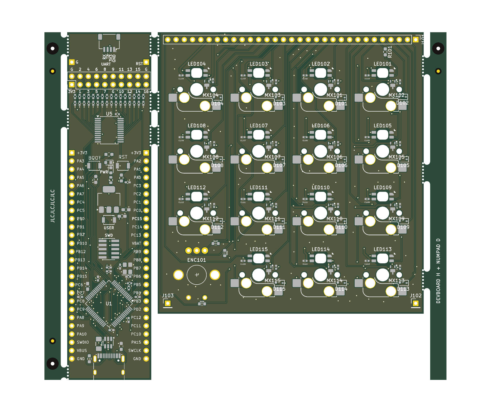
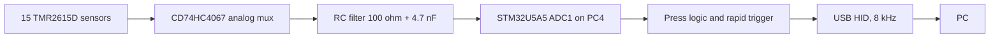
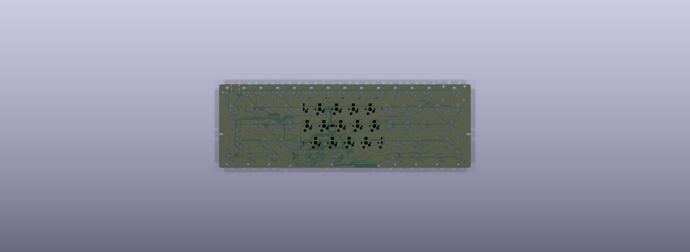
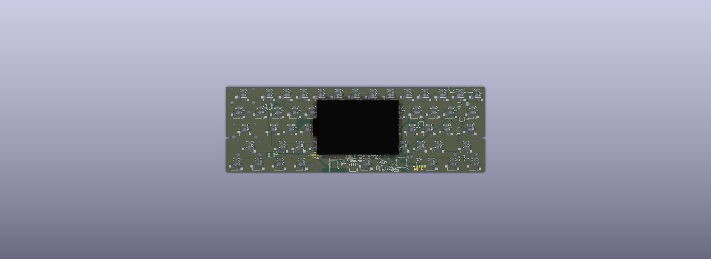

<div align="center">

# Per-Key Precision

### A fast, low-power TMR analog keyboard on the STM32U5A5

From an RP2040 QMK macro pad to a from-scratch firmware, with every board, measurement and mistake written down.




[Quick start](#quick-start) | [Results](#results-so-far) | [The boards](#the-boards) | [Docs](#find-what-you-need) | [Roadmap](#whats-next) | [License](#license)

</div>

---

## What this is

A capstone project to build a keyboard that senses how far each key is pressed, using TMR (tunnel magnetoresistance) sensors, and reports it to a PC over USB at 8 kHz. The firmware is written from scratch for an STM32U5A5, replacing an earlier QMK proof of concept on an RP2040. The goals are speed, a reliable connection, low power draw and a robust feature set.

This repository holds everything: the firmware, the KiCad hardware for every board revision, the bench results, the research, the presentations, and the reasoning behind each decision.

## How it works



Each sensor outputs a voltage that moves as a magnet gets closer. One 16-way mux feeds a single ADC pin, so the firmware scans the keys one after another. At 8 kHz a full scan has to finish in 125 microseconds. The simple blocking scan takes 730 microseconds for 16 inputs, so a faster pipelined scan has been written; it is the next thing to test on the board. [How the sensing works](docs/03-tmr-sensing-guide.md) explains the details in plain language.

## Results so far

| What | Result | Status |
|---|---|---|
| USB report rate | 7999 reports per second, 0 dropped in 10 seconds | Measured on a PC |
| TMR numpad self-test | 14 of 15 keys pass | Observed on the bench; key K4 is open and parked |
| Blocking scan time | 730 microseconds for 16 inputs | Measured; too slow for 8 kHz |
| Fast pipelined scan with rapid trigger | Written, passes PC tests and a syntax check | Not yet built for the board or run on hardware |
| Full tri-mode keyboard (TriMode60) | Designed through Rev E | Design only, not built |

Things marked as not yet run have not been observed on hardware. The docs keep that difference on purpose. The [bench write-up](docs/04-bench-bringup-2026-11-18.md) has the numbers and how each problem was found.

## The boards

| Board | Purpose | Layers | Status |
|---|---|---|---|
| [Dev board Rev K](hardware/devboard-u5a5/RevK/) | STM32U5A5 development board with USB-C, SWD, a 16-channel mux and a sensor header | 4 | Built and in use |
| [Numpad TMR1 Rev E](hardware/numpad-tmr/RevE/) | 15 TMR sensors in a numpad layout, wired to the dev board | 2 | Built, 14 of 15 keys pass |
| [TriMode60 Rev E](hardware/trimode60/RevE/) | 61 sensors, USB, Bluetooth LE and 2.4 GHz radio in one board | 4 | Designed, not built |

<p align="center">
  
  
</p>

Every revision of every board has notes on what changed and why, with before and after pictures, in [Hardware evolution](docs/02-hardware-evolution.md).

## Quick start

You need a Windows PC with STM32CubeIDE installed (the scripts use the compiler and tools that come with it), VS Code, and the dev board plus numpad.

**1. Build the firmware**

```powershell
cd stm32u5a5-keypad
.\tools\build.ps1
```

**2. Flash over USB**

Connect the dev board with a data cable, hold BOOT, tap RST, release BOOT, then:

```powershell
.\tools\flash-usb.ps1
```

Press RST afterwards. Prebuilt images are in [`binaries/`](binaries/) if you only want to flash.

**3. Run the PC tests (no board needed)**

```powershell
.\tools\test-host.ps1
```

**4. Try the TMR fast-scan image** (not yet run on hardware)

```powershell
cd future_work\2026-11-18_tmr_fast\tools
.\build-tmr-fast.ps1
.\flash-tmr-fast-usb.ps1
.\tmr-console.ps1
```

In the console press `t` for the self-test, then `x` for the sweep that measures noise. Full steps, ports and troubleshooting are in the [Build, flash and test guide](docs/05-build-flash-test-guide.md).

## Find what you need

| I want to... | Read |
|---|---|
| Understand the whole story | [Project story](docs/01-project-story.md) |
| See how the boards changed | [Hardware evolution](docs/02-hardware-evolution.md) |
| Learn how the sensors and ADC work | [TMR sensing guide](docs/03-tmr-sensing-guide.md) |
| See what was measured and what broke | [Bench bring-up](docs/04-bench-bringup-2026-11-18.md) |
| Build, flash and test | [Build, flash and test guide](docs/05-build-flash-test-guide.md) |
| Compare with other 8K TMR keyboards | [8 kHz scanning and market research](docs/06-8k-scanning-and-market-research.md) |
| Know what comes next | [Roadmap](docs/07-roadmap.md) |
| Avoid my mistakes | [Lessons learned](docs/08-lessons-learned.md) |
| Open or order the KiCad boards | [KiCad guide](docs/09-kicad-guide.md) |
| Find a presentation or report | [Presentations and reports](docs/10-presentations-and-reports.md) |
| See how it started on the RP2040 | [RP2040 proof of concept](docs/rp2040-proof-of-concept.md) |

## What is in the repository

| Folder | Contents |
|---|---|
| [`stm32u5a5-keypad/`](stm32u5a5-keypad/) | The firmware, PC tests, build tools and the diagnostic test images. Its `docs/STATUS.md` is the day-to-day status |
| [`hardware/`](hardware/) | KiCad projects, production files and revision notes for all three boards |
| [`docs/`](docs/) | The guides listed above |
| [`reports/`](reports/) | Presentations, the Rev H overview, instructor feedback and the capstone deck source |
| [`binaries/`](binaries/) | Prebuilt `.bin` and `.hex` images of each verified step |
| [`cubemx/`](cubemx/) | STM32CubeMX configuration files |
| [`rp2040-reference/`](rp2040-reference/) | Material from the RP2040 stage |
| Repo root, [`ble_bridge/`](ble_bridge/), [`esb_bridge/`](esb_bridge/), [`esb_dongle/`](esb_dongle/), [`schematics/`](schematics/) | The original RP2040 QMK keypad, its wireless bridges and early schematics |

## What's next

1. Replace the open sensor on key K4 and recheck columns 3 and 4 of the matrix.
2. Build and run the fast scan image on the board, then read the noise sweep.
3. Tune the press thresholds and rapid trigger from real data.
4. Add low-power modes and measure current draw.
5. Build TriMode60 and bring up the radio.

The full ordered list, with reasons, is in the [Roadmap](docs/07-roadmap.md).

## License

Code and hardware designs are MIT, documentation and images are CC BY 4.0, and the reports in `reports/` are all rights reserved. ST and Arm code keeps its own licenses, and the QMK-based RP2040 files are GPL-2.0-or-later. The USB ID 0483:5710 used for bench work is ST's demonstration ID and must be replaced before any product is shared or sold. The exact terms are in [`LICENSE`](LICENSE).

<div align="center">

Made by Tyler Judkins, computer engineering technology, Central Connecticut State University

</div>
