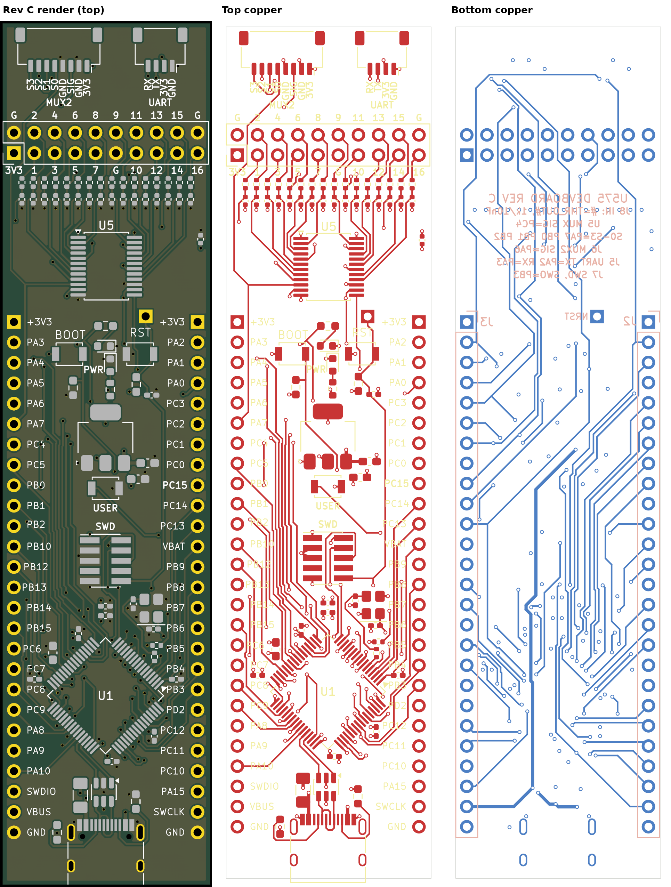
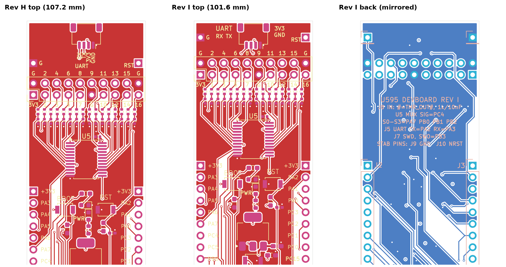
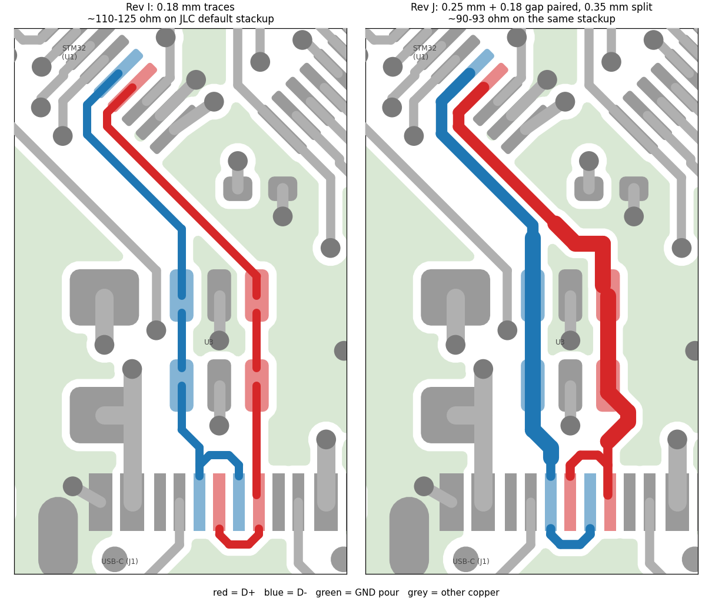
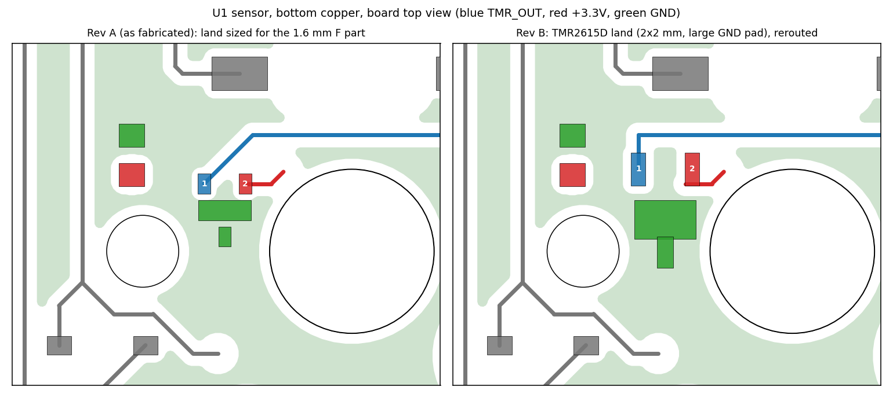
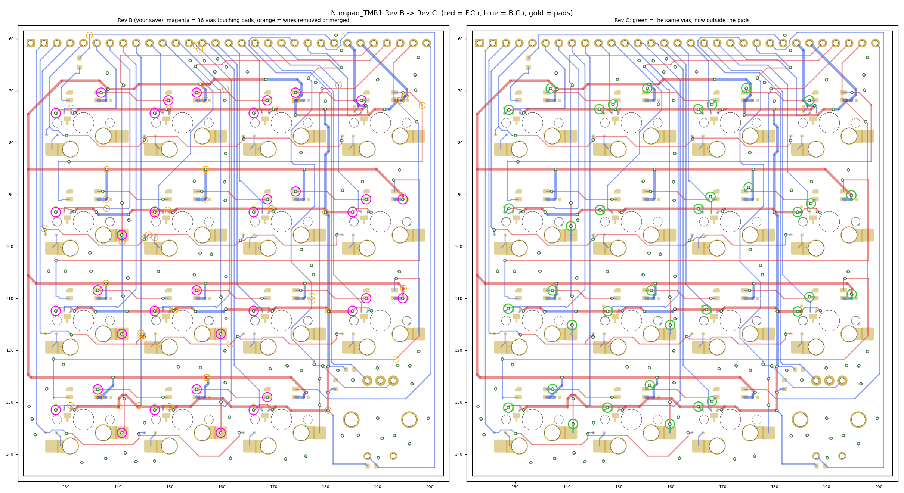
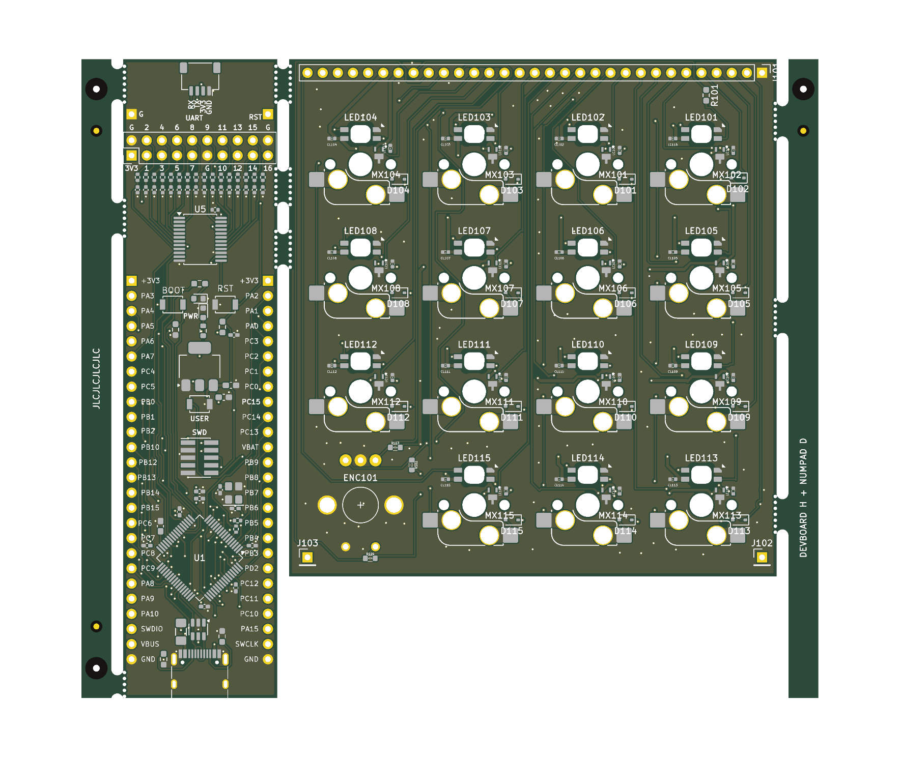
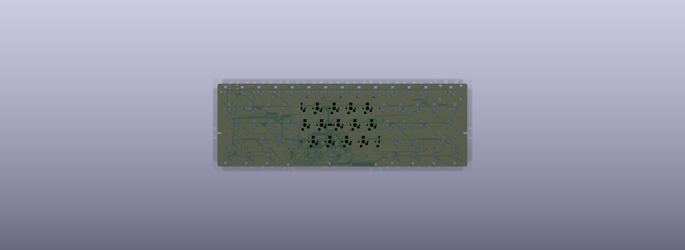
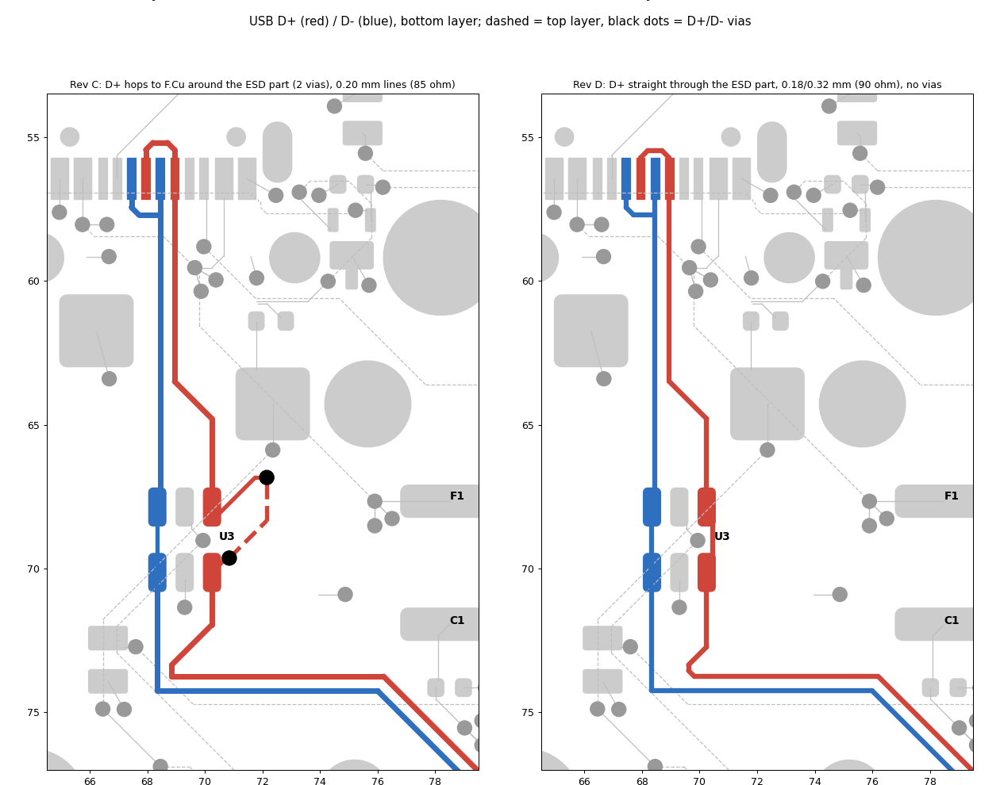

# Hardware evolution

Every board was revised in small, checked steps. Each revision lives in its own folder with a README that says what changed, why, and what checks were run (DRC, ERC, schematic parity, via-in-pad). The notes are kept under [`hardware/history/`](../hardware/history/); the latest sources are in [`hardware/`](../hardware/).

All images below are in `hardware/images/`. They are layout comparisons and renders exported from the KiCad projects. No new schematic exports were made for this repository, so open the `.kicad_sch` files in KiCad to see the schematics.

## Dev board (U575 Rev A to U5A5 Rev K)

A 4-layer board for firmware work: MCU, USB-C with high-speed pair, UART and SWD connectors, an on-board CD74HC4067 mux and a 2x10 sensor header (J8).

| Rev | What changed | Why |
|---|---|---|
| B | QSPI flash removed, UART (USART2) JST-SH added, MCU moved next to USB-C, USB pair via-free with 45-degree bends over a solid ground plane | Professor review of Rev A |
| C | On-board 16:1 mux (COM to PC4, S0 to S3 on PA7, PB0, PB1, PB2), J8 header for 16 sensor outputs, 1 k + 10 nF RC on every input | Read the numpad sensors without an external mux |
| D | Two stabilizer pins (J9 GND, J10 NRST) at the tail | Support the board in a breadboard so cables do not stress solder joints |
| E | Unnecessary copper and vias removed | Cleanup, no netlist change |
| F | External mux connector J6 removed, C25 decoupling moved next to the mux supply pin | Fewer parts, tighter bypass |
| G | STM32U575 to STM32U595; USB lines routed straight through the ESD part, 90 ohm pair | Needs USB high speed for 8 kHz polling |
| H | UART connector centred | Layout |
| I | Board shortened to 101.6 mm | JLC prices a 4-layer board of 102 x 102 mm or less at its low special rate |
| J | USB pair re-routed for about 90 ohm on JLC's default stackup | The 90 ohm stackup cannot be used with Economic PCBA |
| K | STM32U5A5 (pin-compatible, cheaper); mux input RC changed to 100 ohm / 4.7 nF | Settling time and the sensor's 10 nF maximum load |

*Rev C: the on-board mux and J8 sensor header.*

*Rev I: top end moved to bring the board under JLC's size threshold.*

*Rev J: USB pair re-routed for about 90 ohm differential impedance.*

### Why the Rev K filter matters

The mux's common pin has about 50 pF. Each time the channel changes, that charge is shared with the next input's filter capacitor, leaving an error of roughly 50 / (C + 50) of the difference between the two channels, which then decays through the resistor. With 1 k / 10 nF the time constant is 10 us (about 50 us per channel to settle to 14 bits, so a 16-key scan near 1.2 kHz). With 100 ohm / 4.7 nF it is 0.47 us (about 2.5 us per channel, so a scan above 15 kHz is possible on paper). The TMR2615 datasheet limits load capacitance on its output to 10 nF, which the old filter sat exactly on. These are design-time estimates; the measured channel-to-channel memory is what the `x` sweep in the fast image is for.

## Numpad (Numpad_TMR1 Rev A to E)

A 2-layer 15-key board: hot-swap MX sockets, one TMR2615D per key, SK6812 LEDs, and a 31-pin header (J1) that carries sensor outputs, power and encoder signals.

| Rev | What changed | Why |
|---|---|---|
| B | New TMR2615D footprint from the datasheet package drawing | Rev A's pads fit the smaller 2F package, so every sensor read open |
| C | 36 vias moved out of pads; J2 merged into J1 | Via-in-pad is a solder and DRC risk |
| D | Sensor shifted 0.51 mm north and rerouted; duplicate switch holes removed (90 NPTH to 45); J2/J3 stabilizer pins | Cleaner drilling and mechanical support |
| E | ENC_SW trace moved 0.24 mm inboard of the edge | DRC edge clearance. Ordered on its own, not panelled, because JLC charges extra for mixed panels |

*Rev B: the sensor land that did not match the 2 x 2 mm part, and the fix.*

*Rev C: vias moved out of pads.*

The panel experiment (dev board Rev H with numpad Rev D in one panel) is described in [`hardware/history/Panel_Devboard_RevH_Numpad_RevD/`](../hardware/history/Panel_Devboard_RevH_Numpad_RevD/README_PANEL.txt) and was not used for the final order.

## TriMode60 (Rev A to E)

A GH60-compatible 60% keyboard board, 285.1 x 94.7 mm, 4 layers, all parts on the bottom. It is a design: no build or test results are recorded here.

| Rev | What changed |
|---|---|
| A | First full design with 26 connections left unrouted (not orderable) |
| B | Fully routed; power switch rework; power traces widened |
| C | USB-C PD sink (HUSB238) asking for 9 V / 2 A; BQ25895 5 A charger; 3 A PTC and TVS |
| D | USB high-speed pair tuned to 90 ohm and length-matched; D+ passes straight through the ESD part |
| E | Three parts swapped for JLC Basic or Preferred equivalents to avoid per-part loading fees; copper unchanged |

